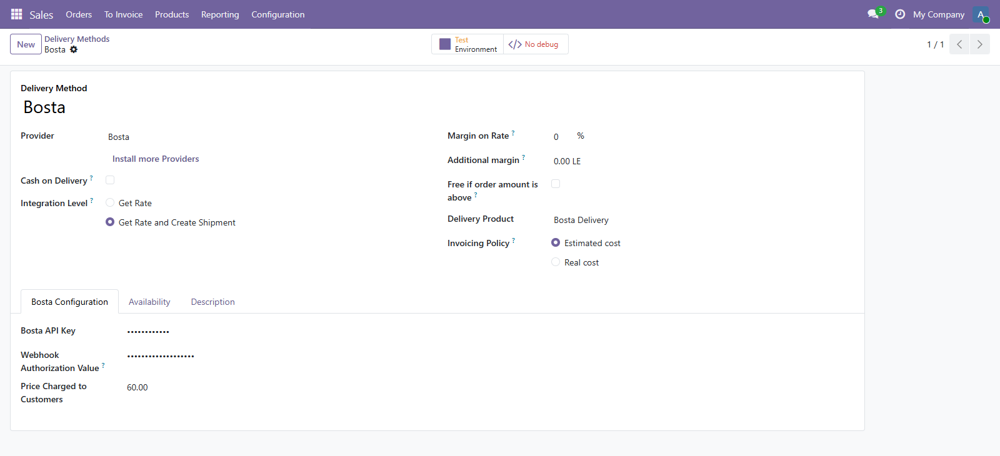
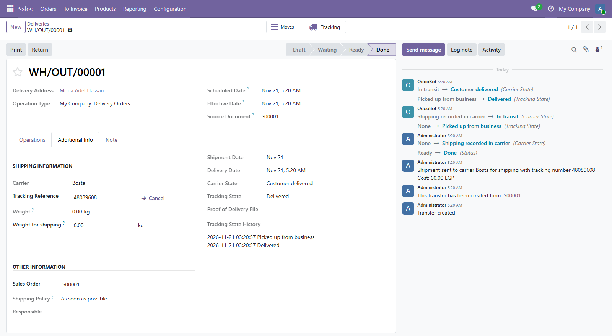

.. image:: https://odoo-community.org/readme-banner-image
   :target: https://odoo-community.org/get-involved?utm_source=readme
   :alt: Odoo Community Association

==============
Delivery Bosta
==============

.. 
   !!!!!!!!!!!!!!!!!!!!!!!!!!!!!!!!!!!!!!!!!!!!!!!!!!!!
   !! This file is generated by oca-gen-addon-readme !!
   !! changes will be overwritten.                   !!
   !!!!!!!!!!!!!!!!!!!!!!!!!!!!!!!!!!!!!!!!!!!!!!!!!!!!
   !! source digest: sha256:783661ad1ce07d31f2690ae0a947db3c80932f9ef35071f328fb525e0db329fd
   !!!!!!!!!!!!!!!!!!!!!!!!!!!!!!!!!!!!!!!!!!!!!!!!!!!!

.. |badge1| image:: https://img.shields.io/badge/maturity-Alpha-red.png
    :target: https://odoo-community.org/page/development-status
    :alt: Alpha
.. |badge2| image:: https://img.shields.io/badge/license-LGPL--3-blue.png
    :target: http://www.gnu.org/licenses/lgpl-3.0-standalone.html
    :alt: License: LGPL-3
.. |badge3| image:: https://img.shields.io/badge/github-OCA%2Fdelivery--carrier-lightgray.png?logo=github
    :target: https://github.com/OCA/delivery-carrier/tree/19.0/delivery_bosta
    :alt: OCA/delivery-carrier
.. |badge4| image:: https://img.shields.io/badge/weblate-Translate%20me-F47D42.png
    :target: https://translation.odoo-community.org/projects/delivery-carrier-19-0/delivery-carrier-19-0-delivery_bosta
    :alt: Translate me on Weblate
.. |badge5| image:: https://img.shields.io/badge/runboat-Try%20me-875A7B.png
    :target: https://runboat.odoo-community.org/builds?repo=OCA/delivery-carrier&target_branch=19.0
    :alt: Try me on Runboat

|badge1| |badge2| |badge3| |badge4| |badge5|

This module adds `Bosta <https://bosta.co>`__, an Egyptian courier, as a
delivery carrier.

- Validating a delivery order creates the delivery in Bosta and stores
  the tracking number on the transfer, with a link to Bosta's public
  tracking page.
- When the sales order was paid with Odoo's Cash on Delivery payment
  method, Bosta is asked to collect the order total. Prepaid orders are
  sent without a cash amount.
- Each delivery is created with this database's webhook URL and a secret
  Authorization value. Bosta then posts every state change, and the
  module records it in the tracking state, the tracking history, and the
  carrier state of ``delivery_state`` (in transit, incident, customer
  delivered, returned, canceled).
- Addresses are checked before anything is sent, and Bosta's own error
  message is shown when it rejects a delivery.

.. IMPORTANT::
   This is an alpha version, the data model and design can change at any time without warning.
   Only for development or testing purpose, do not use in production.
   `More details on development status <https://odoo-community.org/page/development-status>`_

**Table of contents**

.. contents::
   :local:

Configuration
=============

1. In the Bosta dashboard, go to *Settings > API Integration* and create
   an API key. A key with Read/Write access is enough, since Odoo only
   creates deliveries.
2. In Odoo, go to *Inventory > Configuration > Delivery > Delivery
   Methods* and create a delivery method with the provider **Bosta**.
3. On the **Bosta Configuration** tab, set the API key, a webhook
   Authorization value (any long random string), and the price charged
   to customers.
4. On the **Availability** tab, restrict the method to Egypt.
5. Bosta must be able to reach the webhook: the ``web.base.url`` system
   parameter must be the public HTTPS address of this database, and a
   server hosting several databases needs a ``dbfilter`` so that address
   serves exactly one of them.

The optional ``delivery_bosta.api_url`` system parameter replaces the
Bosta API address (default ``https://app.bosta.co/api/v2``), for example
to point at a test server.

|Bosta configuration on a delivery method|

Usage
=====

1. On a quotation, click **Add shipping**, choose the Bosta delivery
   method, and confirm the order.
2. Validate the delivery order. Odoo sends it to Bosta and stores the
   tracking number; the **Tracking** button opens Bosta's tracking page.
   This happens on validation when the operation type has *Generate
   Shipping Labels* enabled, which is the default for delivery orders;
   otherwise click **Send to Shipper**.
3. As Bosta moves the parcel, the transfer's carrier state, tracking
   state, and tracking history update, and each change is logged in the
   chatter by OdooBot.

Each transfer gets exactly one request, with a 30-second timeout, and no
automatic retry: Bosta documents no idempotency key, so a retry could
create a second delivery. When Bosta does not answer in time, the error
gives the business reference (sales order and transfer names) to look
for in the Bosta dashboard before sending again.

Webhook updates are checked against each Bosta delivery method's secret
before anything else, so a wrong value gets a 401 and one method's
secret cannot update another method's transfers. Updates older than the
last one applied (by Bosta's ``timeStamp``) and repeated updates change
nothing.

|Transfer after Bosta's status updates|

Known issues / Roadmap
======================

- The module follows Bosta's public API documentation and is tested
  against mocked responses. It has not yet been validated against a live
  Bosta account.
- Cancelling from Odoo is not supported, because Bosta's public
  documentation does not show the path of its terminate endpoint. Cancel
  in the Bosta dashboard; the cancellation then arrives through the
  webhook.
- Rates use the delivery method's fixed price, since Bosta prices depend
  on each business's contract.
- Addresses send the state (governorate) or city and the street lines,
  without district or zone identifiers. The city must be a name Bosta
  recognises, such as Cairo, Giza, or Alexandria.
- Cash on delivery collects the remaining order total on an order's
  first shipment; later shipments of the same order collect nothing.
- Only standard deliveries (Bosta type 10) are created. Exchanges,
  customer returns, cash collection orders, and package dimensions are
  not covered.
- Bosta's webhook authentication is a static header without a signature,
  so a captured request could be replayed. Replays can only repeat a
  status or send an older one, which is ignored.

Bug Tracker
===========

Bugs are tracked on `GitHub Issues <https://github.com/OCA/delivery-carrier/issues>`_.
In case of trouble, please check there if your issue has already been reported.
If you spotted it first, help us to smash it by providing a detailed and welcomed
`feedback <https://github.com/OCA/delivery-carrier/issues/new?body=module:%20delivery_bosta%0Aversion:%2019.0%0A%0A**Steps%20to%20reproduce**%0A-%20...%0A%0A**Current%20behavior**%0A%0A**Expected%20behavior**>`_.

Do not contact contributors directly about support or help with technical issues.

Credits
=======

Authors
-------

* Yahia Sherif

Contributors
------------

- Yahia Sherif (https://github.com/Yahiasherif002)

Maintainers
-----------

This module is maintained by the OCA.

.. image:: https://odoo-community.org/logo.png
   :alt: Odoo Community Association
   :target: https://odoo-community.org

OCA, or the Odoo Community Association, is a nonprofit organization whose
mission is to support the collaborative development of Odoo features and
promote its widespread use.

.. |maintainer-Yahiasherif002| image:: https://github.com/Yahiasherif002.png?size=40px
    :target: https://github.com/Yahiasherif002
    :alt: Yahiasherif002

Current `maintainer <https://odoo-community.org/page/maintainer-role>`__:

|maintainer-Yahiasherif002| 

This module is part of the `OCA/delivery-carrier <https://github.com/OCA/delivery-carrier/tree/19.0/delivery_bosta>`_ project on GitHub.

You are welcome to contribute. To learn how please visit https://odoo-community.org/page/Contribute.
