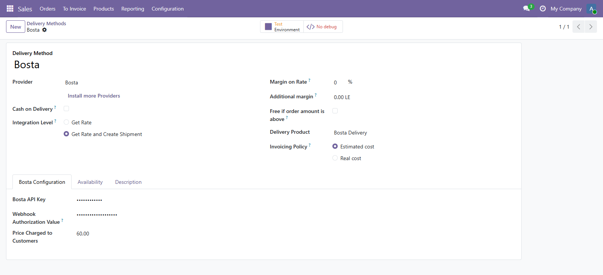

1. In the Bosta dashboard, go to *Settings > API Integration* and create an API key.
   A key with Read/Write access is enough, since Odoo only creates deliveries.
2. In Odoo, go to *Inventory > Configuration > Delivery > Delivery Methods* and create
   a delivery method with the provider **Bosta**.
3. On the **Bosta Configuration** tab, set the API key, a webhook Authorization value
   (any long random string), and the price charged to customers.
4. On the **Availability** tab, restrict the method to Egypt.
5. Bosta must be able to reach the webhook: the `web.base.url` system parameter must
   be the public HTTPS address of this database, and a server hosting several
   databases needs a `dbfilter` so that address serves exactly one of them.

The optional `delivery_bosta.api_url` system parameter replaces the Bosta API address
(default `https://app.bosta.co/api/v2`), for example to point at a test server.

