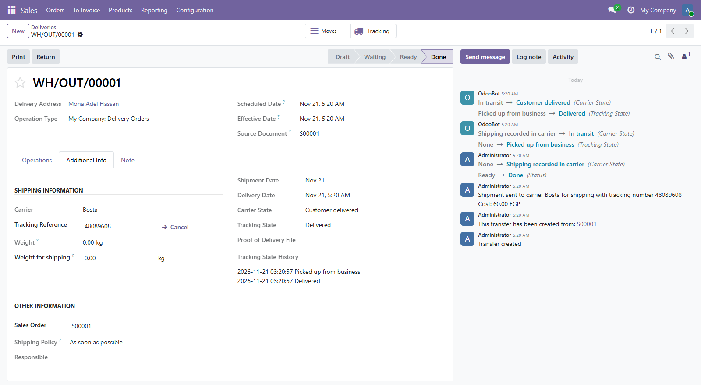

1. On a quotation, click **Add shipping**, choose the Bosta delivery method, and
   confirm the order.
2. Validate the delivery order. Odoo sends it to Bosta and stores the tracking number;
   the **Tracking** button opens Bosta's tracking page. This happens on validation when
   the operation type has *Generate Shipping Labels* enabled, which is the default for
   delivery orders; otherwise click **Send to Shipper**.
3. As Bosta moves the parcel, the transfer's carrier state, tracking state, and tracking
   history update, and each change is logged in the chatter by OdooBot.

Each transfer gets exactly one request, with a 30-second timeout, and no automatic retry:
Bosta documents no idempotency key, so a retry could create a second delivery. When
Bosta does not answer in time, the error gives the business reference (sales order and
transfer names) to look for in the Bosta dashboard before sending again.

Webhook updates are checked against each Bosta delivery method's secret before anything
else, so a wrong value gets a 401 and one method's secret cannot update another method's
transfers. Updates older than the last one applied (by Bosta's `timeStamp`) and repeated
updates change nothing.

